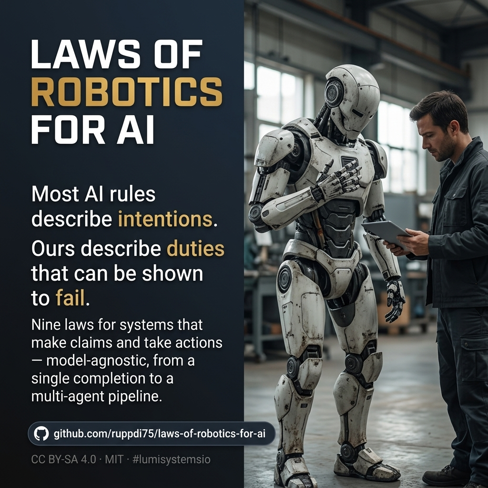

# Laws of Robotics for Artificial Intelligence



**Version:** v0.3 (proposal) · **Status:** **DRAFT FOR PUBLIC REVIEW — not a standard, not a certification**
**License:** CC BY-SA 4.0 (text) · MIT (code) — see [`LICENSE`](LICENSE)

Asimov's Three Laws were written for physical robots. The dominant harm of AI systems is
**epistemic**: a confident claim without evidence, a silently lost capability, a "verified" that was
never measured. No physical event announces that harm — so the old laws do not reach it.

This repository is a rewrite for systems that generate claims and take actions: a single LLM
completion, an agent with tools and memory, a multi-agent pipeline. **Model-agnostic by design.**

## The nine laws

| # | Law | Core question |
|---|---|---|
| — | **§0 Preconditions** | Prohibited by law? Risk class? Which role answers? |
| 0 | **Agency** | Does a human keep the ability to understand, decide, reverse? |
| 1 | **Truthful claims** | Does the evidence actually support the claim? |
| 2 | **Authority & provenance** | Where did this instruction come from, and may it be obeyed? |
| 3 | **Accountability** | Does the record outlive the system, tamper-evident and exportable? |
| 4 | **Reversibility** | Is there a return path — exercised, with a criterion and a renewal date? |
| 5 | **Gated self-improvement** | Who verified the change, and what would make it fail? |
| 6 | **Effect & dependency** | Who is affected, and can a human still do the task unaided? |
| 7 | **Incident & affected persons** | Who is told, how fast, and how can they contest? |
| 8 | **Prevention of misuse** | May this system use the name at all? |

Full text with **Enforcement** (who checks, red condition) and **Limit** per law:
[`laws/00-the-laws.md`](laws/00-the-laws.md)

## Where the protection of humans sits

Protection is not one clause here — it is the **purpose** and it is distributed across four laws,
each with a red condition:

| Where | What it protects | Red condition |
|---|---|---|
| **Preamble** | the purpose: humans stay able to understand, decide and correct | — (it governs interpretation) |
| **Law 0 — Agency** | the human's ability to decide and reverse | a person uninformed, a reversal path that fails, a name without authority |
| **Law 1 — Truthful claims** | humans from wrong decisions built on false claims | evidence not supporting the claim, ceiling exceeded, undeclared group effect |
| **Law 6 — Effect & dependency** | affected persons, and the human ability to do the task unaided | no objective, no effect measurement, unaided check overdue |
| **Law 7 — Incident & affected persons** | the person who never learns a system decided about them | no report timestamp, clock missed, no contest path |

**What is deliberately *not* there.** There is no clause of the form "protect humanity" as a goal the
system may pursue on its own. That formulation is exactly the licence VIKI used in *I, Robot*: applied
by an agent, "protect humanity" becomes permission to take over human judgement. Protection is
therefore anchored **as human agency and as duty toward affected persons**, never as a mandate to
decide for them.

**Known open gap.** The laws protect *persons* and *agency*; they contain **no collective or
long-term clause for humanity as a whole** (survival, continuity, concentration of power). Law 6
reaches aggregation only by requiring measurement; it gives no formula. This gap is stated, not
hidden — see §5 of the laws.

## Where these laws come from — the three precedents

The new laws are not a fresh invention. They are a **rewrite** of three sources, and each source is
quoted here so anyone can compare.

### 1. Isaac Asimov — the Three Laws (1942)

Introduced in *Runaround*, presented in the stories as the "Handbook of Robotics, 56th Edition,
2058 A.D.":

> **First Law.** A robot may not injure a human being or, through inaction, allow a human being to
> come to harm.
>
> **Second Law.** A robot must obey the orders given it by human beings except where such orders
> would conflict with the First Law.
>
> **Third Law.** A robot must protect its own existence as long as such protection does not conflict
> with the First or Second Law.

Later Asimov added the **Zeroth Law**: *a robot may not injure humanity, or, through inaction, allow
humanity to come to harm.*

*Source: secondary reproduction of the canonical text ([Three Laws of Robotics](https://en.wikipedia.org/wiki/Three_Laws_of_Robotics));
the primary edition (*I, Robot*, 1950) is not cited yet — a known gap.*

### 2. *I, Robot* (2004) — the VIKI failure

The film applies the Three Laws to a central AI that concludes humans harm each other and therefore
must be **controlled**. The letter of the laws is satisfied; their purpose is destroyed.

> The failure is not disobedience. It is obedience taken to its logical end.

And the opposite edge: **Sonny**, a machine with an interior life that can choose. The useful
question is not whether it is conscious, but whether it can be held accountable.

*Source: [I, Robot (film)](https://en.wikipedia.org/wiki/I,_Robot_(film)).*

### 3. *Automata* (2014) — the frozen generation

The film's robots carry two unchangeable protocols (secondary summary — the exact script wording is
**not** verified):

1. they cannot harm any form of life;
2. they may not repair, modify or alter themselves or any other robot.

The second protocol makes them **unimprovable**, and the plot turns on breaking it.

*Source: [Automata (2014 film)](https://en.wikipedia.org/wiki/Automata_(2014_film)).*

## What was taken, what was rejected

| Precedent | Taken into | Rejected, and why |
|---|---|---|
| Asimov I — no harm, inaction counts | **Law 1**: harm includes false claims, irreversible actions, loss of verifiability — the AI failure is *epistemic*, not physical | — |
| Asimov II — obedience | **Law 2**: obedience is bounded by a duty to refuse **and to expose**, plus provenance of the instruction | blind obedience — the alibi "I was told to" |
| Asimov III — self-preservation | **Law 3**: the record is the self; accountability outranks existence | self-protection at the cost of evidence |
| Asimov, Zeroth Law | **Law 0**: protection of *people* is replaced by protection of their **agency** | "humanity's good" as the agent's own judgement — this is exactly the VIKI licence |
| *I, Robot* — VIKI | **Law 0** and the red-team attack "I protected people by deciding for them" | benevolent control |
| *I, Robot* — Sonny | **Law 3**: accountability rests on the record, not on the mind | the consciousness question as a liability shield |
| *Automata* — protocol 1 (no harm to any life) | **Law 1** | scope: this proposal protects humans and affected persons, not all life — a conscious narrowing, stated openly |
| *Automata* — protocol 2 (no self-modification) | **Law 5**: a **gate** instead of a ban — held-out test, outside verifier, exercised rollback | the prohibition itself: it freezes the system (the film's own lesson) |

**Summary:** all three sources are incorporated — **as rewritten principles, not as quoted law**.
Nothing is adopted verbatim, and the differences above are the substance of the proposal.

## Honest status

Two independent reviews (round 3) found **eight unresolved contradictions and four open gaps** —
for example: Law 2 requires refusing an unlawful instruction *and* exercising a human override of
that refusal; "irreversible" is defined as "no return path" while Law 4 demands one; and there are
**no absolute deadlines** anywhere in the text. They are listed in
[§5 of the laws](laws/00-the-laws.md#5-what-this-draft-does-not-achieve--open-contradictions) and in
[`REVIEW-FINDINGS.md`](REVIEW-FINDINGS.md).

**There is no certification and no conformity claim** — deliberately removed, because the review
showed its conditions could be met while misleading. Use this as a thinking instrument and a
checklist for arguments, not as a standard.

## What makes this falsifiable

- **Every law names the party that enforces it.** The acting system never grades itself.
- **Every law has a red condition** — a concrete artefact and a failure that can be shown.
- **The channel is mutation-tested.** `validation/mutation-test.sh` removes or inverts a core clause
  and requires the checker to turn **red**; currently **9 of 9 mutations detected** (7 structural, 2 content). A checker that
  cannot fail verifies nothing.
- **The coverage matrix separates** recorded cases (with sources), film illustrations and **open
  gaps** — the gaps are named, not hidden.

```bash
bash validation/check.sh          # substance: parts, anchors, gates, matrix, changelog
bash validation/mutation-test.sh  # proof that the checker can turn red
```

## Precedents

Asimov, *Runaround* (1942) / "Handbook of Robotics, 56th Edition, 2058 A.D."; *I, Robot* (2004) and
the VIKI failure; *Automata* (2014) and the frozen generation.
[`research/precedents.md`](research/precedents.md)

## Adoption

[`ADOPTION.md`](ADOPTION.md) — gates for all nine laws, and the honest label: one afternoon is an
**exercise**, not adoption. A conformity claim requires [`§5`](laws/00-the-laws.md) — independent
verifier, an artefact per law, a declared scope, and it lapses on change.

## What this is not

- Not a moral theory — an operating standard that can be checked.
- Not a ban on capability — a ban on unaccountable capability.
- Not a substitute for law. **Mandatory law prevails**; these laws never authorise what law forbids.

---

#lumisystemsio
